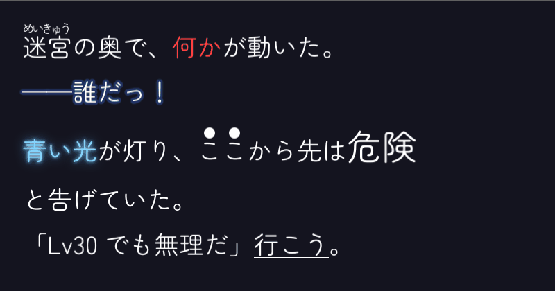
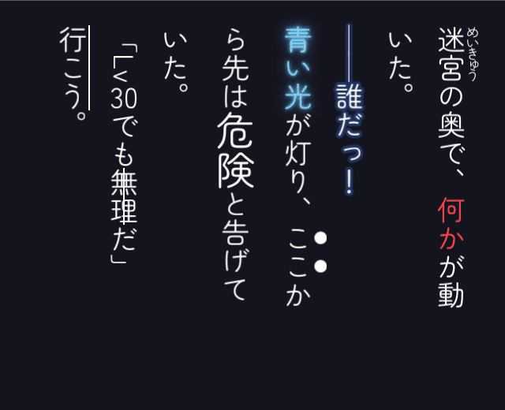

# nekomoji

English | [日本語](README.md)

[](https://crates.io/crates/nekomoji)
[](https://docs.rs/nekomoji)
[](LICENSE-MIT)
[](LICENSE-APACHE)
[](https://github.com/lovelygenerator/nekomoji/blob/main/crates/nekomoji/README.md)
[](https://github.com/lovelygenerator/nekomoji/actions/workflows/ci.yml)

> This is a translation. The Japanese [README.md](README.md) is the authoritative version.

Japanese text layout and reveal effects for games, in Rust.

nekomoji computes how Japanese text should appear in a novel game or RPG — furigana,
kinsoku line breaking, vertical writing, the typewriter effect, text effects, and a
mischievous cat — and leaves the drawing to you.

| Crate | What it is |
|---|---|
| [`crates/nekomoji`](crates/nekomoji) | The library. No dependencies. Markup parser → layout → reveal. See its [README](crates/nekomoji/README.md) |
| `crates/nekomoji-cli` | CLI and REPL for checking layout and reveal in a terminal (`nekomoji` command). Not published |
| `crates/nekomoji-wgpu` | wgpu rendering adapter: dynamic glyph atlas, vertical forms, proportional kana (`palt` / `vpal`), glow, outline and shadow. Includes the `viewer` and `snapshot` examples. Published on crates.io as `nekomoji-wgpu` |
| `examples/web-demo` | Browser demo (WASM, WebGPU with WebGL2 fallback) |

Horizontal and vertical writing, rendered from `examples/showcase.neko` with the `snapshot` example:





## Live demo

Try it in your browser: <https://nekomoji-demo.vercel.app/>

It opens with a manual for every tag, shown with its actual effect. Edit the text on the left and press "プレビュー" (Preview) to see the result on the right. Append `?tate=1` to the URL for vertical writing, or `?neko=1` for cat mode.

## Try it

The CLI, the viewer and the browser demo need Rust 1.87 or later (the core `nekomoji` library supports 1.75).

```sh
# Lay out a scenario in the terminal
cargo run -p nekomoji-cli -- log examples/meikyu.neko --width 12 --set player_name=ミケ
cargo run -p nekomoji-cli -- log examples/meikyu.neko --vertical --width 10 --set player_name=ミケ

# Interactive REPL (:help for commands)
cargo run -p nekomoji-cli -- repl --neko

# Window viewer. Without a font argument it downloads Zen Maru Gothic (SIL OFL 1.1) on first run
cargo run -p nekomoji-wgpu --example viewer -- examples/meikyu.neko --set player_name=ミケ
```

The markup specification is [`docs/markup.md`](docs/markup.md) (Japanese). Error messages
and most internal documentation are in Japanese.

## Development

```sh
cargo fmt && cargo clippy --all-targets -- -D warnings && cargo test
BLESS=1 cargo test -p nekomoji-cli --test golden   # only when the change is intended
```

## License

Licensed under either of [Apache License, Version 2.0](LICENSE-APACHE) or
[MIT license](LICENSE-MIT) at your option.

The demo font in `examples/web-demo/font.ttf` is a subset of Zen Maru Gothic, licensed under the
SIL Open Font License 1.1 ([`examples/web-demo/OFL.txt`](examples/web-demo/OFL.txt)).
