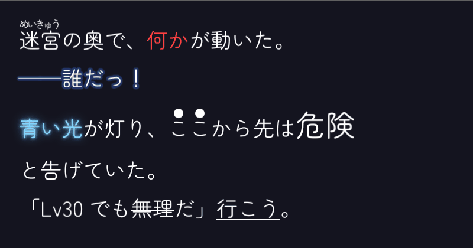
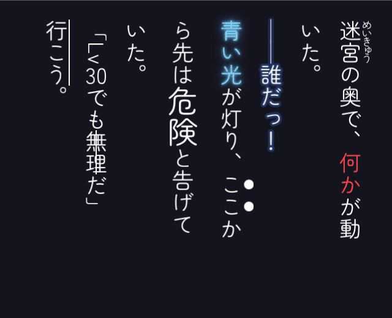

# nekomoji(ねこもじ)

[English](README.en.md) | 日本語

[](https://crates.io/crates/nekomoji)
[](https://docs.rs/nekomoji)
[](LICENSE-MIT)
[](LICENSE-APACHE)
[](https://github.com/lovelygenerator/nekomoji/blob/main/crates/nekomoji/README.md)
[](https://github.com/lovelygenerator/nekomoji/actions/workflows/ci.yml)

ゲーム向けに、日本語テキストの組版と文字送りを計算する Rust のライブラリです。ルビ・禁則・縦書き・上付き/下付き・取り消し線/下線・文字送り・演出タグを扱います。文字をどこに置き、いつ出し、どう動かすかを計算して返すので、描画はお使いのエンジンやライブラリに任せられます。

- `crates/nekomoji`: コアのライブラリ(外部の依存なし)。パーサ → レイアウト → 文字送りの順に処理します
- `crates/nekomoji-cli`: 動作を確かめるための CLI と REPL(`nekomoji` コマンド)
- `crates/nekomoji-wgpu`: wgpu で描くためのアダプタ(crates.io の [`nekomoji-wgpu`](https://crates.io/crates/nekomoji-wgpu) で公開。動的なグリフのアトラス・肉球のカーソル・縦書き用の字形・仮名のプロポーショナル詰め・発光・縁取りと影)。依存は `wgpu`・`fontdue`・`bytemuck`・`ttf-parser`(GSUB の `vert` と GPOS の `palt`・`vpal` を読むのに使っています。fontdue と同じ版)

マークアップの書き方は [docs/markup.md](docs/markup.md) にまとめています。

横書きと縦書きの例です(`examples/showcase.neko` を `snapshot` で画像にしたもの)。





## Web デモ

ブラウザですぐに試せます: <https://nekomoji-demo.vercel.app/>

全タグの説明書を、実際の効果つきで読めます。左のテキストを書き換えて「プレビュー」を押すと、右に結果が出ます。URL の末尾に `?tate=1` を付けると縦書き、`?neko=1` を付けると猫モードになります。

## 5分で試す

CLI・viewer・ブラウザのデモは Rust 1.87 以上で動きます(ライブラリのコア `nekomoji` は 1.75 から使えます)。

```sh
cargo run -p nekomoji-cli -- log examples/meikyu.neko --width 12 --set player_name=ミケ
cargo run -p nekomoji-cli -- repl
```

REPL では、たとえば次のように試せます。

```text
nekomoji> [ruby ねこ]猫[/ruby]が「にゃーん」と鳴いた。[voice cat01][p][var name]は振り返った。
nekomoji> :width 6
nekomoji> :set name ミケ
nekomoji> :step 0.5
nekomoji> :next
nekomoji> :play
```

`:help` でコマンドの一覧を出せます。

### 猫モード

猫が文字にちょっかいを出します。文字送りの途中で通りすがりに文字を猫パンチで飛ばしたり、入力待ちのあいだに最後の文字を押して落としたり、ときどきページの文字をまとめて散らしたりします。飛んだ文字は数秒すると元の位置にふわっと戻ってきます(テキストそのものは変わりません)。入力待ちのカーソルは肉球です。`[neko hop]…[/neko]` で、文字を猫のように跳ねさせて出すこともできます。

```sh
cargo run -p nekomoji-cli -- repl --neko --knock 1      # 端末では飛んだ文字が空白になり、カーソルは 🐾(--ascii で =^.^=)
cargo run -p nekomoji-wgpu --example viewer -- <日本語フォント>   # 窓で文字が飛ぶ様子を見られます(NEKOMOJI_BURST=1 で毎ページ散らします)
```

### viewer

シナリオのファイルと nekomoji の出力を確かめるための道具です(ゲームを進める機能はありません)。窓で文字送りを見ながら、文字の大きさ・行の長さ・行数・書字方向をキーで切り替えられ、論理座標(行・字の枠・ルビ・上限・カーソル・猫の位置)を重ねて表示できます。シナリオのファイルを保存すると自動で読み直し、フォントに無い文字や値の無い変数があれば端末に知らせます。マウスの下の文字の元の位置(行・桁)・変数・名前付きの範囲(`[mark id]`)をタイトルに出して範囲を強調し、範囲の上でクリックするとその範囲を選べます。

```sh
cargo run -p nekomoji-wgpu --example viewer -- examples/meikyu.neko --set player_name=ミケ --grid
```

フォントを指定しないときは `assets/fonts/` の Zen Maru Gothic(SIL OFL 1.1)を使います。まだ無ければ、初回に公式のリポジトリから取ってきます(約 4 MB。git には入りません)。どの環境でも同じ見た目で確かめられます。取ってきてほしくないときは `NEKOMOJI_NO_FETCH=1` を付けると、OS の日本語フォントを使います。別のフォントを使うときは、パスを渡す(`viewer <フォント> <.neko>`)か、`NEKOMOJI_FONT` に入れてください。

Windows(Git Bash)では、`./scripts/windows-check.sh` でフォントの取得と viewer をまとめて確かめられます。

キー: `+` `-` 大きさ、`]` `[` 行の長さ、`L` 行数、`V` 縦横、`G` 重ね描き、`F` 文字に合わせた枠、`M` 範囲をすべて強調、`N` 猫、`O` 動きの強さ(標準・控えめ・なし)、`A` 揃えの既定、`I` 字下げ、`E` 縁取りと影の既定、`U` オートモード、`P` 一時停止、`←` `→` ページ、`R` 読み直し、`H` 一覧。窓のタイトルには、マウスの下の論理座標も出ます。

### 縦書き

```sh
cargo run -p nekomoji-cli -- log examples/meikyu.neko --vertical --width 10 --set player_name=ミケ
NEKOMOJI_VERTICAL=1 cargo run -p nekomoji-wgpu --example viewer -- <日本語フォント>
```

REPL では `:writing tate` で切り替えられます。フォントの縦書き用の字形(`vert`)を使い、字形が無い文字は回転やずらしで補います。

## ライブラリとして使う

```rust
use nekomoji::{parse, CellMetrics, Layout, LayoutOptions, Reveal, RevealOptions, Vars};

let script = parse("[ruby めいきゅう]迷宮[/ruby]の奥で、何かが動いた。")?;
// 設定は Default から builder で組み立てます
let opts = LayoutOptions::default().max_width(18.0).max_lines(3);
let layout = Layout::build(&script, &CellMetrics, &opts, &Vars::new());
let mut reveal = Reveal::new(&layout, RevealOptions::default());

// 毎フレーム
for event in reveal.advance(dt) { /* voice・se・入力待ちなど */ }
for glyph in reveal.glyphs(&layout) { /* 描画側で描く */ }
```

毎フレームの割り当てを減らしたいときは、`reveal.glyphs_into(&layout, &mut buf)` で同じ `Vec` に書けます(猫モードでは `neko.glyphs_into(&layout, &reveal, &mut buf)`、取り消し線・下線は `reveal.decorations_into(&layout, &mut buf)`)。

描画側では `FontMetrics`(文字の送り幅)を実装して渡します。`CellMetrics` は端末向けの実装です(全角 1.0、半角 0.5)。

猫モードを使うときは `Neko` を作り、`reveal.glyphs` の代わりに `neko.glyphs` を描きます(どれも時刻の関数です)。入力待ちのカーソルの位置は `reveal.cursor` で取れます(何を描くかはお好みで)。

```rust
use nekomoji::{Neko, NekoMode};

let neko = Neko::new(&layout, NekoMode::default().seed(42));
for glyph in neko.glyphs(&layout, &reveal) { /* 飛ばされた文字は回りながら飛び、数秒後に戻ります */ }
if let Some(c) = reveal.cursor(&layout) { /* 入力待ち: 最後の文字の後ろ(c.x, c.line)にカーソル */ }
```

縦書きは `LayoutOptions::default().vertical()` で有効になります。位置は横書きと同じく「行頭からの位置 `x` と行の番号」で返ります。`x` は行の中を下へ進み、行は右から左へ並びます。描画側では、文字ごとに `vertical_form(ch)`(立てる/寝かせる/句読点/小書きの仮名)を見て置き方を決められます。

取り消し線・下線は、`reveal.decorations(&layout)` が行ごとの線分(表示済みの文字の分)を返します。上付き・下付きの文字は、`GlyphInstance::baseline_size` の大きさで、ベースラインから `rise` だけずらして描きます。

バックログには `layout.pages[i].text()` が使えます(ルビは `｜親文字《よみ》` の形)。セーブ・ロードは、`reveal.state()` を保存しておき、`reveal.restore(state)` で戻します(文字列 `p<ページ> t<秒> l<秒>,…` にもできます)。

設定と出力の型には `#[non_exhaustive]` を付けているので、構造体の式(`LayoutOptions { .. }`)では作れません。設定は builder のメソッドで組み立て、出力は読むだけにしてください。そうしておけば、項目が増えてもお使いのコードは壊れません。

## 開発

```sh
cargo fmt && cargo clippy --all-targets -- -D warnings && cargo test
BLESS=1 cargo test -p nekomoji-cli --test golden   # 意図した変更のときだけ期待値を更新
```

## ライセンス

次のどちらかを選んでお使いいただけます。

- Apache License, Version 2.0([LICENSE-APACHE](LICENSE-APACHE))
- MIT license([LICENSE-MIT](LICENSE-MIT))
